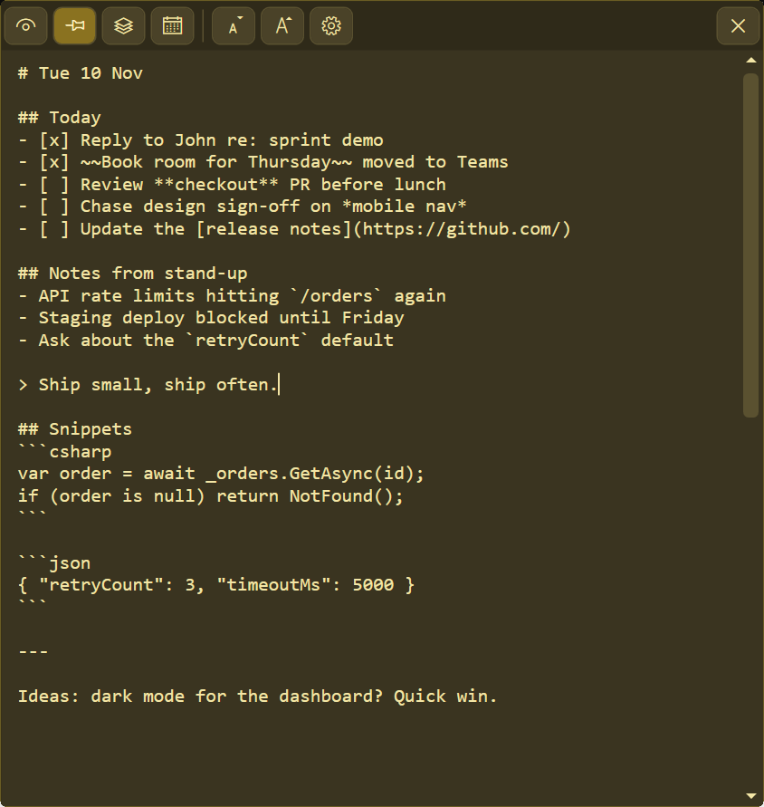
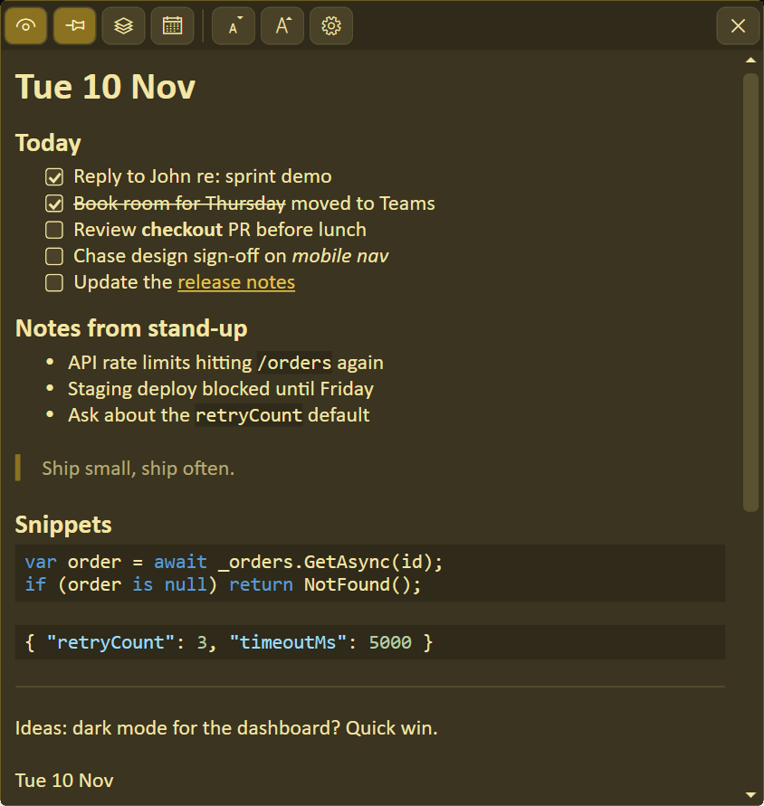

# Scratchpad

A markdown scratch note for Windows. There's one note, so you never have to pick a
file. It sits in the tray, saves as you type, and switches between raw markdown and
a rendered preview.

| Edit | Preview |
| --- | --- |
|  |  |

## Features

- Tray icon, taskbar button, optional always-on-top, and a global hotkey (Win+Shift+N
  by default).
- Saves continuously, and keeps local backups: hourly, on exit, and before a large delete.
- Ctrl+E switches between editor and preview and keeps your place. Double-click the
  preview to edit at that spot.
- The preview has clickable checkboxes and links, strikethrough, and syntax
  highlighting for C#, JSON, JavaScript, HTML/XML and CSS code blocks.
- Ctrl+; inserts today's date. Typing `*`, `_`, `` ` `` or `~` over a selection wraps it.
  Tab and Shift+Tab indent or outdent selected lines.
- Peek (Ctrl+Shift+click) slides the note off screen for a few seconds.
- Light and dark themes that follow Windows, separate fonts and sizes for the editor
  and preview, and a configurable date format and hotkey.

The note is stored at `%LOCALAPPDATA%\Scratchpad\scratchpad.md`, with settings and
backups in the same folder.

## Building

You need the .NET 10 SDK to build, and Windows with .NET Framework 4.8 to run it.

```powershell
dotnet build Scratchpad.sln -c Release
dotnet test Scratchpad.Core.Tests
```

The app is `Scratchpad\bin\Release\net48\Scratchpad.exe`. There's no installer and it
doesn't need admin rights. Copy the folder wherever you like and run it once. It adds
itself to your per-user startup list (`HKCU\...\Run`) so it starts when you sign in.

`Scratchpad.Core` (netstandard2.0) holds the logic and the tests cover it. It builds on
any platform. The WPF app in `Scratchpad` targets `net48` and only runs on Windows.
